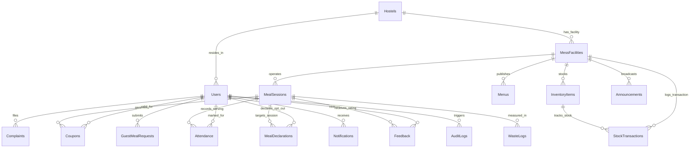

# MessMate — Database Schema Architecture & Design

> **Version:** 1.0  
> **Last Updated:** November 2026  
> **Database:** MongoDB 6.0+ with Mongoose ODM (Node.js)  
> **Architecture Pattern:** Multi-Tenant Hostel Partitioning via Scoped Document References

---

## 1. Schema Overview & Relationship Architecture

MessMate models hostel mess operations across five key functional domains:
1. **Core Identity & Access:** Users, Hostels, MessFacilities, AuditLogs
2. **Meal Life Cycle & Operations:** Menus, MealSessions, MealDeclarations, Coupons, Attendance
3. **Quality & Grievance:** Feedback (Meal Ratings), Complaints
4. **Supply Chain & Waste Management:** InventoryItems, StockTransactions, WasteLogs
5. **Engagement & Communication:** GuestMealRequests, Announcements, Notifications

### Entity-Relationship Diagram (ERD)



---

## 2. Detailed Collection Schemas

---

### 1. `Users`
Stores authentication credentials, profile details, and role-based assignments.

```javascript
{
  _id: ObjectId,
  firstName: { type: String, required: true, trim: true, maxlength: 50 },
  lastName: { type: String, required: true, trim: true, maxlength: 50 },
  email: { type: String, required: true, unique: true, lowercase: true, trim: true, index: true },
  password: { type: String, required: true, select: false }, // Hashed using bcryptjs (salt factor 12)
  role: { 
    type: String, 
    required: true, 
    enum: ['student', 'mess_staff', 'mess_manager', 'warden', 'admin'],
    default: 'student',
    index: true 
  },
  rollNumber: { 
    type: String, 
    sparse: true, 
    unique: true, 
    trim: true, 
    uppercase: true, 
    index: true 
  }, // Required if role === 'student'
  phone: { type: String, trim: true },
  avatarUrl: { type: String, default: null },
  hostel: { type: ObjectId, ref: 'Hostel', default: null, index: true },
  mess: { type: ObjectId, ref: 'MessFacility', default: null, index: true },
  isActive: { type: Boolean, default: true, index: true },
  isEmailVerified: { type: Boolean, default: false },
  passwordResetToken: { type: String, default: null, select: false },
  passwordResetExpires: { type: Date, default: null, select: false },
  lastLogin: { type: Date, default: null },
  createdAt: { type: Date, default: Date.now },
  updatedAt: { type: Date, default: Date.now }
}
```

*Indexes:*
- `{ email: 1 }` (unique)
- `{ rollNumber: 1 }` (unique, sparse)
- `{ hostel: 1, role: 1 }` (compound for room/hostel lookups)
- `{ mess: 1, role: 1 }` (compound for mess staff and student lookups)

---

### 2. `Hostels`
Physical residence halls hosting students and mapped to dining halls.

```javascript
{
  _id: ObjectId,
  name: { type: String, required: true, trim: true, unique: true }, // e.g., "Kosi Hostel", "Ganga Hall"
  code: { type: String, required: true, trim: true, uppercase: true, unique: true }, // e.g., "H-KOSI"
  address: { type: String, trim: true },
  capacity: { type: Number, required: true, min: 1 },
  warden: { type: ObjectId, ref: 'User', default: null },
  isActive: { type: Boolean, default: true },
  createdAt: { type: Date, default: Date.now },
  updatedAt: { type: Date, default: Date.now }
}
```

*Indexes:*
- `{ code: 1 }` (unique)
- `{ name: 1 }` (unique)

---

### 3. `MessFacilities`
Dining halls and kitchens associated with hostels, setting meal hours and cutoff rules.

```javascript
{
  _id: ObjectId,
  name: { type: String, required: true, trim: true }, // e.g., "Mess Block A"
  hostel: { type: ObjectId, ref: 'Hostel', required: true, index: true },
  manager: { type: ObjectId, ref: 'User', required: true },
  mealTimings: {
    breakfast: {
      start: { type: String, required: true, default: "07:30" }, // 24-hr format "HH:mm"
      end: { type: String, required: true, default: "09:30" }
    },
    lunch: {
      start: { type: String, required: true, default: "12:30" },
      end: { type: String, required: true, default: "14:30" }
    },
    dinner: {
      start: { type: String, required: true, default: "19:30" },
      end: { type: String, required: true, default: "21:30" }
    }
  },
  declarationCutoffs: {
    breakfast: { type: String, required: true, default: "21:00" }, // e.g. 21:00 the night before
    lunch: { type: String, required: true, default: "09:00" },     // 09:00 same day
    dinner: { type: String, required: true, default: "15:00" }     // 15:00 same day
  },
  billingPolicy: {
    type: String,
    enum: ['fixed_monthly', 'per_meal'],
    default: 'fixed_monthly'
  },
  isActive: { type: Boolean, default: true },
  createdAt: { type: Date, default: Date.now },
  updatedAt: { type: Date, default: Date.now }
}
```

*Indexes:*
- `{ hostel: 1 }`
- `{ manager: 1 }`

---

### 4. `MealSessions`
Represents an actual scheduled dining event on a specific date.

```javascript
{
  _id: ObjectId,
  mess: { type: ObjectId, ref: 'MessFacility', required: true, index: true },
  date: { type: Date, required: true, index: true }, // Normalized to midnight UTC (YYYY-MM-DD 00:00:00)
  mealType: { 
    type: String, 
    required: true, 
    enum: ['breakfast', 'lunch', 'dinner'],
    index: true 
  },
  status: { 
    type: String, 
    enum: ['upcoming', 'active', 'completed', 'cancelled'], 
    default: 'upcoming',
    index: true
  },
  startTime: { type: Date, required: true },
  endTime: { type: Date, required: true },
  totalEligibleResidents: { type: Number, default: 0 },
  optOutCount: { type: Number, default: 0 },
  approvedGuestCount: { type: Number, default: 0 },
  declaredDemand: { type: Number, default: 0 }, // eligible - optOut + guest
  historicalPredictedDemand: { type: Number, default: 0 },
  recommendedPreparationQuantity: { type: Number, default: 0 },
  managerAdjustedQuantity: { type: Number, default: 0 },
  actualServedCount: { type: Number, default: 0 },
  createdAt: { type: Date, default: Date.now },
  updatedAt: { type: Date, default: Date.now }
}
```

*Indexes:*
- `{ mess: 1, date: 1, mealType: 1 }` (unique compound index - only 1 session per meal type per day)
- `{ date: 1, status: 1 }` (query upcoming/active sessions across system)

---

### 5. `Menus`
Defines weekly rotating dishes or special holiday menus.

```javascript
{
  _id: ObjectId,
  mess: { type: ObjectId, ref: 'MessFacility', required: true, index: true },
  dayOfWeek: { type: Number, min: 0, max: 6, required: true }, // 0 = Sunday, 1 = Monday, ...
  mealType: { type: String, required: true, enum: ['breakfast', 'lunch', 'dinner'] },
  dishes: [{
    name: { type: String, required: true, trim: true },
    category: { type: String, enum: ['staple', 'main_curry', 'side_dish', 'beverage', 'dessert', 'salad_snack'], default: 'main_curry' },
    description: { type: String, trim: true },
    isVeg: { type: Boolean, default: true },
    allergens: [{ type: String, trim: true }] // e.g. ["dairy", "gluten", "nuts"]
  }],
  isSpecial: { type: Boolean, default: false },
  specialDate: { type: Date, default: null }, // If special event meal (e.g. Diwali Feast)
  specialMealName: { type: String, default: null },
  createdBy: { type: ObjectId, ref: 'User' },
  publishedAt: { type: Date, default: Date.now },
  createdAt: { type: Date, default: Date.now },
  updatedAt: { type: Date, default: Date.now }
}
```

*Indexes:*
- `{ mess: 1, dayOfWeek: 1, mealType: 1, isSpecial: 1 }` (unique constraint for standard weekly menu)

---

### 6. `MealDeclarations`
Tracks student advance absence notices / opt-outs.

```javascript
{
  _id: ObjectId,
  student: { type: ObjectId, ref: 'User', required: true, index: true },
  mess: { type: ObjectId, ref: 'MessFacility', required: true, index: true },
  mealSession: { type: ObjectId, ref: 'MealSession', default: null, index: true },
  date: { type: Date, required: true, index: true }, // Normalized to YYYY-MM-DD
  mealType: { type: String, required: true, enum: ['breakfast', 'lunch', 'dinner'], index: true },
  status: { 
    type: String, 
    enum: ['declared', 'cancelled', 'expired', 'admin_override'], 
    default: 'declared',
    index: true 
  },
  reason: { type: String, trim: true, default: null }, // Optional: "Travelling home", "Medical"
  declaredAt: { type: Date, default: Date.now },
  cancelledAt: { type: Date, default: null },
  cancelledBy: { type: ObjectId, ref: 'User', default: null },
  isLateCancel: { type: Boolean, default: false },
  auditNote: { type: String, default: null },
  createdAt: { type: Date, default: Date.now },
  updatedAt: { type: Date, default: Date.now }
}
```

*Indexes:*
- `{ student: 1, date: 1, mealType: 1 }` (unique compound index: a student can have at most one declaration record per meal slot)
- `{ mess: 1, date: 1, mealType: 1, status: 1 }` (fast aggregation for demand prediction)

---

### 7. `Coupons`
Time-limited cryptographic tokens issued to students to claim meals.

```javascript
{
  _id: ObjectId,
  student: { type: ObjectId, ref: 'User', required: true, index: true },
  mealSession: { type: ObjectId, ref: 'MealSession', required: true, index: true },
  tokenHash: { type: String, required: true, unique: true, index: true }, // SHA-256 hash of random UUID/hex string
  qrPayload: { type: String, required: true }, // Encrypted / signed payload rendered in client QR code
  status: { 
    type: String, 
    enum: ['active', 'redeemed', 'expired', 'invalidated'], 
    default: 'active',
    index: true 
  },
  generatedAt: { type: Date, default: Date.now },
  redeemedAt: { type: Date, default: null },
  redeemedBy: { type: ObjectId, ref: 'User', default: null }, // Mess staff member who scanned
  expiresAt: { type: Date, required: true, index: true },
  createdAt: { type: Date, default: Date.now }
}
```

*Indexes:*
- `{ student: 1, mealSession: 1 }` (unique compound index: exactly one coupon generated per student per meal session)
- `{ tokenHash: 1 }` (unique)
- `{ expiresAt: 1 }` (TTL or index lookup for expiration validation)

---

### 8. `Attendance`
Immutable record of an authorized meal redemption (either via QR or staff manual entry).

```javascript
{
  _id: ObjectId,
  student: { type: ObjectId, ref: 'User', required: true, index: true },
  mealSession: { type: ObjectId, ref: 'MealSession', required: true, index: true },
  coupon: { type: ObjectId, ref: 'Coupon', default: null }, // Null if verified manually
  verificationMethod: { 
    type: String, 
    enum: ['qr_scan', 'manual_roll_lookup', 'card_swipe', 'admin_override'], 
    required: true,
    default: 'qr_scan'
  },
  verifiedBy: { type: ObjectId, ref: 'User', required: true }, // Staff ID
  manualReason: { type: String, default: null }, // Required if manual (e.g. "Phone battery dead")
  timestamp: { type: Date, default: Date.now, index: true },
  createdAt: { type: Date, default: Date.now }
}
```

*Indexes:*
- `{ student: 1, mealSession: 1 }` (unique compound index: ensures a student can never be marked attended twice for the same meal)
- `{ mealSession: 1, timestamp: 1 }` (real-time attendance tracking)

---

### 9. `Feedback` (Meal Ratings)
Post-meal student reviews rating specific culinary and dining qualities.

```javascript
{
  _id: ObjectId,
  student: { type: ObjectId, ref: 'User', required: true, index: true },
  mealSession: { type: ObjectId, ref: 'MealSession', required: true, index: true },
  attendance: { type: ObjectId, ref: 'Attendance', required: true }, // Enforces attended-first verification
  ratings: {
    taste: { type: Number, min: 1, max: 5, required: true },
    hygiene: { type: Number, min: 1, max: 5, required: true },
    temperature: { type: Number, min: 1, max: 5, required: true },
    portionSize: { type: Number, min: 1, max: 5, required: true },
    overall: { type: Number, min: 1, max: 5, required: true }
  },
  comment: { type: String, trim: true, maxlength: 500 },
  isFlagged: { type: Boolean, default: false }, // If comment contains abusive or urgent safety alerts
  managerResponse: {
    text: { type: String, trim: true },
    respondedAt: { type: Date },
    respondedBy: { type: ObjectId, ref: 'User' }
  },
  createdAt: { type: Date, default: Date.now }
}
```

*Indexes:*
- `{ student: 1, mealSession: 1 }` (unique compound index: one review per student per meal)
- `{ mealSession: 1 }` (aggregation for session scorecards)

---

### 10. `Complaints`
Structured grievance tracking with workflow state progression, photos, and SLA timers.

```javascript
{
  _id: ObjectId,
  complaintId: { type: String, required: true, unique: true, index: true }, // e.g. "CMP-2026-0042"
  complainant: { type: ObjectId, ref: 'User', required: true, index: true },
  mess: { type: ObjectId, ref: 'MessFacility', required: true, index: true },
  category: { 
    type: String, 
    required: true,
    enum: [
      'food_quality', 
      'hygiene', 
      'quantity', 
      'undercooked_stale', 
      'staff_behaviour', 
      'long_queues', 
      'drinking_water', 
      'infrastructure', 
      'other'
    ],
    index: true
  },
  priority: { 
    type: String, 
    enum: ['low', 'medium', 'high', 'critical'], 
    default: 'medium',
    index: true 
  },
  subject: { type: String, required: true, trim: true, maxlength: 120 },
  description: { type: String, required: true, trim: true, maxlength: 2000 },
  images: [{ type: String }], // Cloudinary secure URLs
  status: { 
    type: String, 
    enum: ['submitted', 'assigned', 'under_review', 'in_progress', 'resolved', 'escalated', 'closed'],
    default: 'submitted',
    index: true
  },
  isConfidential: { type: Boolean, default: false }, // Hides student identity from mess staff/managers
  assignedTo: { type: ObjectId, ref: 'User', default: null },
  resolutionDeadline: { type: Date, index: true },
  resolvedAt: { type: Date, default: null },
  responses: [{
    by: { type: ObjectId, ref: 'User', required: true },
    role: { type: String, required: true },
    message: { type: String, required: true, trim: true },
    isInternal: { type: Boolean, default: false }, // Visible to staff/warden only
    createdAt: { type: Date, default: Date.now }
  }],
  escalatedTo: { type: ObjectId, ref: 'User', default: null },
  escalatedAt: { type: Date, default: null },
  escalationReason: { type: String, default: null },
  createdAt: { type: Date, default: Date.now, index: true },
  updatedAt: { type: Date, default: Date.now }
}
```

*Indexes:*
- `{ complaintId: 1 }` (unique)
- `{ mess: 1, status: 1, priority: 1 }`
- `{ complainant: 1, createdAt: -1 }`

---

### 11. `InventoryItems`
Raw food materials, condiments, produce, and cooking essentials.

```javascript
{
  _id: ObjectId,
  mess: { type: ObjectId, ref: 'MessFacility', required: true, index: true },
  name: { type: String, required: true, trim: true }, // e.g. "Basmati Rice", "Mustard Oil"
  category: { 
    type: String, 
    required: true,
    enum: ['grain', 'vegetable', 'oil', 'dairy', 'spice', 'pulse', 'meat_egg', 'other'] 
  },
  unit: { 
    type: String, 
    required: true, 
    enum: ['kg', 'litre', 'pieces', 'packets', 'gram'] 
  },
  currentStock: { type: Number, required: true, min: 0, default: 0 },
  minimumThreshold: { type: Number, required: true, min: 0, default: 10 }, // Low-stock trigger
  unitCostEstimate: { type: Number, default: 0 }, // For wastage cost calculations
  isActive: { type: Boolean, default: true },
  lastRestockedAt: { type: Date, default: null },
  createdAt: { type: Date, default: Date.now },
  updatedAt: { type: Date, default: Date.now }
}
```

*Indexes:*
- `{ mess: 1, name: 1 }` (unique compound index per facility)
- `{ mess: 1, currentStock: 1, minimumThreshold: 1 }` (fast query for low stock alerts)

---

### 12. `StockTransactions`
Audit log of stock inflows (purchases), outflows (kitchen cooking consumption), and adjustments.

```javascript
{
  _id: ObjectId,
  item: { type: ObjectId, ref: 'InventoryItem', required: true, index: true },
  mess: { type: ObjectId, ref: 'MessFacility', required: true, index: true },
  type: { 
    type: String, 
    required: true, 
    enum: ['purchase', 'consumption', 'adjustment', 'spoilage_wastage'],
    index: true 
  },
  quantity: { type: Number, required: true }, // Positive value
  previousStock: { type: Number, required: true },
  newStock: { type: Number, required: true },
  unitPrice: { type: Number, default: 0 }, // Purchase cost
  vendor: { type: String, trim: true, default: null },
  invoiceNumber: { type: String, trim: true, default: null },
  remarks: { type: String, trim: true },
  recordedBy: { type: ObjectId, ref: 'User', required: true },
  timestamp: { type: Date, default: Date.now, index: true },
  createdAt: { type: Date, default: Date.now }
}
```

*Indexes:*
- `{ item: 1, timestamp: -1 }`
- `{ mess: 1, type: 1, timestamp: -1 }`

---

### 13. `WasteLogs`
Empirical measurement of physical food waste per meal session (weighed on scale).

```javascript
{
  _id: ObjectId,
  mealSession: { type: ObjectId, ref: 'MealSession', required: true, unique: true, index: true },
  mess: { type: ObjectId, ref: 'MessFacility', required: true, index: true },
  totalPreparedServings: { type: Number, required: true, min: 0 },
  totalActualServed: { type: Number, required: true, min: 0 },
  unservedSurplusWeightKg: { type: Number, required: true, min: 0 }, // Unserved food in pots/trays
  plateWasteWeightKg: { type: Number, required: true, min: 0 },      // Scraps scraped off plates
  estimatedCostLostINR: { type: Number, default: 0 },
  disposalMethod: { 
    type: String, 
    enum: ['compost', 'biogas', 'pig_farm_donation', 'municipal_waste', 'other'],
    default: 'municipal_waste' 
  },
  remarks: { type: String, trim: true },
  recordedBy: { type: ObjectId, ref: 'User', required: true },
  createdAt: { type: Date, default: Date.now }
}
```

*Indexes:*
- `{ mealSession: 1 }` (unique)
- `{ mess: 1, createdAt: -1 }`

---

### 14. `GuestMealRequests`
Hostel residents booking advance meals for parents, visiting delegates, or guests.

```javascript
{
  _id: ObjectId,
  requestedBy: { type: ObjectId, ref: 'User', required: true, index: true },
  mess: { type: ObjectId, ref: 'MessFacility', required: true, index: true },
  date: { type: Date, required: true, index: true },
  mealType: { type: String, required: true, enum: ['breakfast', 'lunch', 'dinner'] },
  guestCount: { type: Number, required: true, min: 1, max: 10 },
  purpose: { type: String, trim: true, required: true },
  guestNames: [{ type: String, trim: true }],
  status: { 
    type: String, 
    enum: ['pending', 'approved', 'rejected', 'cancelled'], 
    default: 'pending',
    index: true 
  },
  approvedBy: { type: ObjectId, ref: 'User', default: null },
  approvedAt: { type: Date, default: null },
  chargePerGuest: { type: Number, default: 0 },
  totalCharge: { type: Number, default: 0 },
  paymentStatus: { type: String, enum: ['unpaid', 'paid', 'billed_to_room'], default: 'unpaid' },
  remarks: { type: String, trim: true },
  createdAt: { type: Date, default: Date.now },
  updatedAt: { type: Date, default: Date.now }
}
```

*Indexes:*
- `{ requestedBy: 1, date: -1 }`
- `{ mess: 1, date: 1, status: 1 }`

---

### 15. `Notifications`
User-specific real-time alerts dispatched via WebSockets and stored for notification inbox.

```javascript
{
  _id: ObjectId,
  recipient: { type: ObjectId, ref: 'User', required: true, index: true },
  type: { 
    type: String, 
    required: true,
    enum: [
      'meal_reminder', 
      'cutoff_approaching', 
      'menu_updated', 
      'coupon_ready', 
      'complaint_status', 
      'guest_meal_decision', 
      'low_stock_alert', 
      'announcement'
    ] 
  },
  title: { type: String, required: true, trim: true },
  message: { type: String, required: true, trim: true },
  actionUrl: { type: String, default: null }, // e.g. "/student/complaints/CMP-2026-0042"
  metadata: { type: mongoose.Schema.Types.Mixed, default: {} },
  isRead: { type: Boolean, default: false, index: true },
  readAt: { type: Date, default: null },
  createdAt: { type: Date, default: Date.now, expires: '30d' } // Auto-prune after 30 days
}
```

*Indexes:*
- `{ recipient: 1, isRead: 1, createdAt: -1 }`

---

### 16. `Announcements`
Broadcast bulletin posts published by managers, wardens, or administrators.

```javascript
{
  _id: ObjectId,
  mess: { type: ObjectId, ref: 'MessFacility', default: null, index: true }, // Null for all facilities
  hostel: { type: ObjectId, ref: 'Hostel', default: null, index: true },     // Null for all hostels
  title: { type: String, required: true, trim: true },
  content: { type: String, required: true, trim: true },
  priority: { 
    type: String, 
    enum: ['normal', 'important', 'urgent'], 
    default: 'normal',
    index: true 
  },
  targetRoles: [{ 
    type: String, 
    enum: ['student', 'mess_staff', 'mess_manager', 'warden'] 
  }],
  publishedBy: { type: ObjectId, ref: 'User', required: true },
  publishedAt: { type: Date, default: Date.now },
  expiresAt: { type: Date, default: null },
  isActive: { type: Boolean, default: true, index: true },
  createdAt: { type: Date, default: Date.now },
  updatedAt: { type: Date, default: Date.now }
}
```

*Indexes:*
- `{ isActive: 1, publishedAt: -1 }`

---

### 17. `AuditLogs`
Immutable security and compliance log of all critical transactions and overrides.

```javascript
{
  _id: ObjectId,
  user: { type: ObjectId, ref: 'User', required: true, index: true },
  action: { type: String, required: true, trim: true, index: true }, // e.g. "COUPON_OVERRIDE", "MENU_UPDATED", "STOCK_ADJUSTMENT"
  resource: { type: String, required: true, trim: true }, // e.g. "Coupon", "MealDeclaration"
  resourceId: { type: ObjectId, default: null, index: true },
  previousState: { type: mongoose.Schema.Types.Mixed, default: null },
  newState: { type: mongoose.Schema.Types.Mixed, default: null },
  ipAddress: { type: String, default: null },
  userAgent: { type: String, default: null },
  timestamp: { type: Date, default: Date.now, index: true }
}
```

*Indexes:*
- `{ user: 1, timestamp: -1 }`
- `{ resource: 1, resourceId: 1, timestamp: -1 }`

---

## 3. Data Integrity & Concurrency Guarantees

### A. Atomic Coupon Redemption (Prevent Double-Serving)
To prevent race conditions where a student scans a screenshot or QR twice simultaneously at two counters:
```javascript
const redeemedCoupon = await Coupon.findOneAndUpdate(
  {
    _id: couponId,
    tokenHash: hashedScannedToken,
    status: 'active',
    expiresAt: { $gt: new Date() }
  },
  {
    $set: {
      status: 'redeemed',
      redeemedAt: new Date(),
      redeemedBy: staffUser._id
    }
  },
  { new: true }
);

if (!redeemedCoupon) {
  throw new AppError('Coupon is invalid, expired, or has already been redeemed', 400);
}

// Proceed to create immutable Attendance record
await Attendance.create({
  student: redeemedCoupon.student,
  mealSession: redeemedCoupon.mealSession,
  coupon: redeemedCoupon._id,
  verificationMethod: 'qr_scan',
  verifiedBy: staffUser._id,
  timestamp: new Date()
});
```

### B. Single Active Declaration Rule
By enforcing the compound unique index `{ student: 1, date: 1, mealType: 1 }` on `MealDeclarations`, the database natively prevents double entries across parallel client requests.

---

## 4. Query Patterns & Common Aggregations

### Demand Aggregation Pipeline
To calculate the total expected demand for a meal session:
```javascript
const demandPipeline = [
  {
    $match: {
      mess: messId,
      date: sessionDate,
      mealType: sessionMealType,
      status: 'declared'
    }
  },
  {
    $group: {
      _id: null,
      totalOptOuts: { $sum: 1 }
    }
  }
];
// expectedMeals = totalActiveResidents - totalOptOuts + approvedGuests
```

