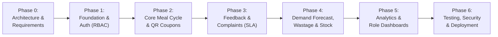

# MessMate — Phase-Wise Implementation Roadmap & Master Execution Plan

> **Project Name:** MessMate — Smart Hostel Mess Management & Food Waste Reduction System  
> **Development Methodology:** Incremental Milestone-Driven Architecture (Do Not Build Everything at Once)  
> **Core Principle:** Every phase must be fully functional, tested, documented, and verified before proceeding to the next.

---

## Executive Roadmap Summary

---

## 1. Engineering Principles & Quality Standards

1. **Working Software First:** No placeholder UI buttons or simulated mock endpoints for core features. Every button must trigger a live backend endpoint and database state transition.
2. **Defensive Concurrency:** All operations involving state consumption (e.g., QR coupon redemption, absence deadlines) must use atomic database operations (`findOneAndUpdate`, transactions, or compound unique constraints).
3. **Role Segregation:** Role checks occur at the backend middleware layer using JWT claims verified against the database. Hiding a button on the client is purely for UX, never for security.
4. **Mobile Usability:** The Student portal and Mess Staff scanning screens must function smoothly on mobile viewports (360px–420px widths).

---

## PHASE 0: Project Inception & Technical Blueprint (COMPLETED)

### Objectives
Establish the architectural blueprint, domain models, REST API specifications, and business rules before generating project code.

### Deliverables
- [x] `docs/PROJECT_REQUIREMENTS.md`: 12 functional modules, user roles, non-functional constraints, and business rules.
- [x] `docs/SYSTEM_ARCHITECTURE.md`: Modular monolithic MERN architecture, security design, Socket.IO rooms, and file upload pipelines.
- [x] `docs/DATABASE_SCHEMA.md`: 17 normalized Mongoose collections, compound unique indexes, and concurrency guarantees.
- [x] `docs/API_DOCUMENTATION.md`: REST API specifications, payload samples, and rate-limiting rules.
- [x] `docs/IMPLEMENTATION_PLAN.md`: Phase-wise roadmap with acceptance criteria and testing gates.

---

## PHASE 1: Project Foundation, Data Models & Authentication

### Focus & Scope
Lay down the MERN monorepo structure, establish MongoDB connection, configure environment variables, build the 5 user role schemas, and establish JWT-in-cookie authentication with protected route guards.

### Detailed Task Breakdown

#### Backend Infrastructure (`/server`)
- [x] Initialize Node.js project with ES Modules (`"type": "module"` in `package.json`).
- [x] Install core dependencies: `express`, `mongoose`, `dotenv`, `cors`, `helmet`, `cookie-parser`, `jsonwebtoken`, `bcryptjs`, `express-rate-limit`, `express-validator`, `morgan`.
- [x] Configure `src/config/database.js` with connection retry logic and index auto-creation.
- [x] Create `src/utils/AppError.js` and centralized `src/middleware/errorHandler.js`.
- [x] Implement `src/models/User.js`, `src/models/Hostel.js`, and `src/models/MessFacility.js`.
- [x] Build `src/middleware/auth.js` (JWT cookie verification) and `src/middleware/authorize.js` (RBAC role verification).
- [x] Implement Authentication Controllers & Routes (`/api/v1/auth`):
  - `POST /register`: Student registration with roll number uniqueness.
  - `POST /login`: Credential validation, bcrypt compare, issuing secure HTTP-only cookie.
  - `POST /logout`: Cookie clearing.
  - `GET /me`: Returns authenticated user context and role.
  - `PUT /profile`: Update phone, name, avatar.
  - `PUT /change-password`: Secure password updating with current password verification.
- [x] Build Admin User Management (`/api/v1/users`):
  - Create staff/manager/warden accounts.
  - Assign users to specific Hostels and Mess Facilities.
- [x] Automated Database Seed Script (`server/src/utils/seedData.js`) with 5 role accounts, hostels, and mess facility.

#### Frontend Infrastructure (`/client`)
- [x] Initialize Vite + React project with Tailwind CSS.
- [x] Configure Tailwind theme (Hostel Mess palette: deep navy, emerald green for attendance, amber warnings, crimson alerts).
- [x] Set up Axios instance (`src/services/api.js`) with `withCredentials: true` and response interceptors for 401 handling.
- [x] Create `AuthContext.jsx` with persistent user state, login, logout, and automatic session restoration via `GET /auth/me`.
- [x] Create Navigation & Layout Shells:
  - `AuthLayout.jsx`: Clean responsive card view for registration and login.
  - `DashboardLayout.jsx`: Responsive layout with collapsible sidebar for desktop and mobile bottom/drawer navigation.
- [x] Implement Route Protection:
  - `ProtectedRoute.jsx`: Redirects unauthenticated traffic to `/login`.
  - `RoleRoute.jsx`: Checks required role permissions and redirects unauthorized attempts.
- [x] Build Authentication Views:
  - `Login.jsx`: Login with validation and loading states.
  - `Register.jsx`: Multi-field student sign-up with dynamic hostel selection.
  - Initial Role Dashboard Skeletons:
    - `/student/dashboard`
    - `/staff/dashboard`
    - `/manager/dashboard`
    - `/warden/dashboard`
    - `/admin/dashboard`
  - Account Profile & Password Settings: `/profile`

### Verification & Testing Gate
1. Register a student with roll number `2201001` -> verifies unique constraint prevents duplicate registration.
2. Login as student -> verifies `Set-Cookie` with `HttpOnly` flag.
3. Access `/api/v1/users` as student -> receives `403 Forbidden`.
4. Refresh frontend page -> verifies `AuthContext` maintains session without flashing login screen.

---

## PHASE 2: Core Mess Operations (Menu, Opt-Out & Digital QR Coupons)

### Focus & Scope
The core operational loop of the hostel mess: publishing the weekly menu, allowing students to opt out prior to cutoff deadlines, generating dynamic QR coupons, and providing the staff QR scanner with manual fallback.

### Detailed Task Breakdown

#### Backend Development
- [x] Implement `src/models/Menu.js`, `src/models/MealSession.js`, `src/models/MealDeclaration.js`, `src/models/Coupon.js`, and `src/models/Attendance.js`.
- [x] Build Menu Management (`/api/v1/menus`):
  - CRUD for weekly menus (Breakfast, Lunch, Dinner).
  - Endpoint `GET /menus/today` retrieving active dishes based on server day and time.
- [x] Build Meal Session Scheduler / Manager:
  - Daily meal session generation (Breakfast, Lunch, Dinner) with start, end, and cutoff times.
- [x] Build Meal Declaration System (`/api/v1/declarations`):
  - `POST /declarations`: Validate student is not already declared; validate submission is prior to meal cutoff.
  - `POST /declarations/bulk`: Date-range hostel leave absence planner.
  - `DELETE /declarations/:id`: Cancel declaration and restore meal eligibility before cutoff.
- [x] Build Digital QR Coupon Engine (`/api/v1/coupons`):
  - `POST /coupons/generate`:
    - Check student is active and belongs to host mess.
    - Check student has NOT opted out in `MealDeclarations`.
    - Check student does NOT already have an attendance record for this meal.
    - Generate unique cryptographic random token, hash and store with session expiry.
  - `POST /coupons/verify`:
    - Mess Staff scanner endpoint.
    - Atomic redemption using `findOneAndUpdate` to prevent double-scanning.
    - Automatically create `Attendance` record and increment session served count.
  - `POST /coupons/manual-verify`:
    - Mess Staff manual fallback: look up student by Roll Number, verify eligibility, and mark attendance.

#### Frontend Development
- [x] Student Weekly Menu View:
  - 7-day responsive carousel/tabs showing breakfast, lunch, and dinner.
  - Allergen chips and veg/non-veg indicators.
- [x] Student Meal Absence Planner:
  - Interactive calendar displaying cutoffs for upcoming meals.
  - Single-meal opt out and date-range hostel leave planner with confirmation.
  - Active list of upcoming declared absences with "Cancel & Restore Meal" option.
- [x] Student Digital Coupon Screen:
  - Large scannable QR code display with countdown timer for expiration.
  - Dynamic status banner: "Active / Ready to Scan", "Redeemed", or "Meal Skipped".
- [x] Mess Staff Scanner Interface:
  - Integrated camera scanner using `html5-qrcode`.
  - Immediate audio/visual feedback on scan:
    - Green checkmark + Student Roll Number + Photo + Meal Type on success.
    - Red alert with loud error description on duplicate or expired coupons.
  - Prominent "Manual Search by Roll Number" tab for students without working phones.
- [x] Mess Manager Menu Editor:
  - Interactive dish builder per day-of-week and meal type with allergen tags.

### Verification & Testing Gate
1. Student declares absence for Lunch -> Student attempts to generate Lunch coupon -> Error: "You have declared absence for this meal".
2. Student with valid coupon scans at Staff scanner -> Successfully redeems and records attendance.
3. Same QR is scanned a second time -> Error: "Coupon already redeemed at [timestamp]".
4. Staff enters Roll Number manually -> Successfully verifies student without QR code.

---

## PHASE 3: Student Experience (Feedback, Grievances & Announcements)

### Focus & Scope
Empower students to rate meals, file actionable complaints with image evidence, track resolution SLAs, and receive real-time mess updates via WebSockets.

### Detailed Task Breakdown

#### Backend Development
- [x] Implement `src/models/Feedback.js`, `src/models/Complaint.js`, `src/models/Announcement.js`, and `src/models/Notification.js`.
- [x] Setup Socket.IO Server (`src/sockets/index.js`):
  - Authenticate socket connection using JWT cookie.
  - Join rooms based on `hostel:<id>`, `mess:<id>`, `role:<role>`, and `user:<userId>`.
- [x] Build Meal Feedback System (`/api/v1/feedback`):
  - `POST /feedback`: Validates student attended the meal session before accepting rating.
  - 5-metric ratings: Taste, Hygiene, Temperature, Portion Size, Overall (1-5 scale).
  - Scorecard calculation with averages per meal session.
  - Manager response capability to student reviews.
- [x] Build Grievance & Complaint Workflow (`/api/v1/complaints`):
  - Auto-generate formatted human-readable IDs (`CMP-2026-0001`).
  - Image evidence proof attachment.
  - Status progression: `submitted` -> `under_review` -> `in_progress` -> `resolved` -> `closed`.
  - Confidential mode: Anonymizes complainant identity from mess staff/managers while allowing warden audit.
  - SLA resolution deadlines (12h for critical/food safety, 24h high, 48h normal).
  - Student reopening capability for inadequately addressed tickets.
- [x] Announcements & Notifications:
  - Broadcast emergency announcements (e.g., "Special Dinner timing changed to 20:00").
  - Socket.IO real-time event emissions (`notification:new`, `announcement:new`, `complaint:new`).

#### Frontend Development
- [x] Student Meal Rating Modal:
  - Verified post-attendance rating page (`/student/feedback`).
  - Interactive 5-star metric ratings with comments and historical scorecard view.
- [x] Student Complaint Portal:
  - "Lodge New Complaint" form (`/student/complaints/new`) with category dropdown, priority, confidentiality toggle.
  - "My Complaints" list (`/student/complaints`) with live status badges (`Submitted`, `Under Review`, `Resolved`).
  - Threaded detail timeline view (`/student/complaints/:id`) with manager responses and "Reopen Ticket" action.
- [x] Manager & Warden Grievance Dashboard:
  - Filterable complaint queue (`/manager/complaints`, `/warden/complaints`) by status and priority.
  - Response dialog to update status and post resolution messages.
- [x] In-App Notification Center:
  - Live bell icon with unread count badge in header.
  - Real-time dropdown alerting menu updates, complaint responses, and reminders.
- [x] Announcements Management Console:
  - Publish broadcasts with priority levels (`/manager/announcements`, `/warden/announcements`).

### Verification & Testing Gate
1. Student who did not attend lunch tries to submit feedback -> Blocked with `400 Attended meal required`.
2. Student submits complaint with image -> Cloudinary returns URL -> Complaint appears on Manager dashboard.
3. Manager marks complaint `Resolved` with message -> Student receives real-time notification via Socket.IO.

---

## PHASE 4: Mess Administration (Demand Prediction, Kitchen Sheet & Wastage)

### Focus & Scope
Connect advance student opt-outs to kitchen operations: forecast meal preparation quantities, provide kitchen staff with clean preparation sheets, monitor actual food wastage, and manage raw inventory.

### Detailed Task Breakdown

#### Backend Development
- [ ] Implement `src/models/WasteLog.js`, `src/models/InventoryItem.js`, `src/models/StockTransaction.js`, and `src/models/GuestMealRequest.js`.
- [ ] Build Smart Demand Prediction Engine (`/api/v1/demand`):
  - Formula: $\text{Declared Demand} = \text{Total Active Residents} - \text{Opt Outs} + \text{Approved Guests}$.
  - Compute historical turnout buffer percentage based on past 30-day attendance.
  - Expose manager endpoint to approve and adjust final preparation quantity.
- [ ] Build Kitchen Preparation Sheet API (`/api/v1/kitchen`):
  - Aggregated view of approved cooking count, special dietary notes, and key menu ingredients.
- [ ] Build Food Wastage Monitoring (`/api/v1/waste-logs`):
  - Separate recording of:
    1. Unserved surplus food weight (kg).
    2. Plate waste weight (kg).
  - Calculate estimated cost lost based on raw material benchmarks.
- [ ] Build Inventory & Stock Tracker (`/api/v1/inventory`):
  - CRUD for items (Rice, Dal, Oil, Vegetables, Milk).
  - Purchase inflow and consumption outflow logging.
  - Low-stock notification triggers when stock drops below threshold.
- [ ] Guest Meal Management (`/api/v1/guest-meals`):
  - Student guest booking request and manager approval pipeline.

#### Frontend Development
- [ ] Manager Demand Prediction View:
  - Card breakdown: Total Residents (500) - Opt Outs (65) + Guests (10) = Expected Meals (445).
  - Visual comparison between Declared Demand and Historical Recommendation.
  - Quick-edit input for Manager to set final approved cooking quantity.
- [ ] Kitchen Preparation Sheet (Tablet / Mobile Friendly):
  - High-contrast, large-font operational screen designed for kitchen staff.
  - Dish names, approved target quantities, and countdown to meal start.
- [ ] Staff Food Wastage Logging Form:
  - Post-meal simple form: Enter Surplus (kg), Plate Waste (kg), and optional notes.
- [ ] Manager Inventory Manager:
  - Visual stock level progress bars with red warning indicators for items near depletion.
  - "Log Stock Transaction" modal (Purchase vs Kitchen Usage).

### Verification & Testing Gate
1. 10 students opt out of Dinner + 2 guest meals approved -> Demand shows exactly `Residents - 10 + 2`.
2. Staff logs 8.5 kg unserved surplus and 5.2 kg plate waste -> Recorded in `WasteLogs` and reflected in wastage dashboard.
3. Stock of "Cooking Oil" drops below 15 Litres -> Low-stock alert appears in notifications.

---

## PHASE 5: Dashboards, Advanced Analytics & Decision Support

### Focus & Scope
Build dedicated, high-impact dashboards for all five roles, featuring Recharts visualizations, monthly wastage summaries, quality trend charts, and administrative audit feeds.

### Detailed Task Breakdown

#### Backend Development
- [ ] Build Aggregated Analytics Engine (`/api/v1/dashboard/*`):
  - Student summary: Attendance rate, upcoming opt-outs, open complaints.
  - Staff summary: Today's meal shifts, scanned headcounts, pending waste logs.
  - Manager summary: Attendance trends, food waste vs demand, inventory alerts.
  - Warden summary: Multi-hostel quality scorecards, grievance resolution times, cost of food waste.
  - Admin summary: System metrics, active users by role, audit log search.

#### Frontend Development
- [ ] Student Dashboard:
  - Welcome hero with student name and hostel.
  - "Next Meal in X hours" card with today's menu preview.
  - Quick action: "Generate Coupon" / "Skip This Meal".
  - Recent announcements banner and open complaint status pills.
- [ ] Mess Staff Dashboard:
  - Active meal indicator with live counter: `Served: 312 / Expected: 445`.
  - Big button to open Camera QR Scanner.
  - Quick Roll Number manual search box.
- [ ] Mess Manager Command Center:
  - Recharts Line & Bar charts: 7-day Attendance vs Demand, Food Wastage (kg).
  - Average Meal Quality Gauge (Taste, Hygiene, Quantity).
  - Urgent alerts panel (Low stock items, high priority complaints).
- [ ] Warden / Committee Oversight Portal:
  - Mess performance rating comparisons over weeks/months.
  - Complaint resolution SLA compliance tracker (% resolved within 48h).
  - Monthly food wastage reduction and cost savings metrics.
- [ ] Super Admin Management Console:
  - User list with role filtering, hostel reassignment, and account deactivation.
  - Hostel & Mess facility configuration panel.
  - Audit logs viewer with search by user, action, and date.

### Verification & Testing Gate
1. All 5 user roles log into their respective accounts and see tailored dashboards.
2. Analytics charts correctly reflect live database entries (attendance, feedback, waste).
3. Responsive design tested on mobile (375px), tablet (768px), and desktop (1440px).

---

## PHASE 6: Testing, Security Hardening & Deployment Preparation

### Focus & Scope
End-to-end integration testing, security penetration testing, automated seed script creation, API documentation with Swagger, and deployment configuration.

### Detailed Task Breakdown

#### Security & Quality Assurance
- [ ] Input Validation & Sanitization: Audit all request handlers with `express-validator`.
- [ ] Rate Limiting Verification: Confirm rate limits prevent brute force on `/auth/login` and `/coupons/verify`.
- [ ] CORS & Security Headers: Verify Helmet configuration, XSS protection, and restrictive CORS origins.
- [ ] Concurrency & Race Condition Test: Run simultaneous automated coupon redemption requests with Jest/Supertest to confirm no double-redemption.
- [ ] Automated Database Seed Script (`server/src/utils/seedData.js`):
  - Pre-populates 1 Admin, 2 Wardens, 2 Mess Managers, 4 Mess Staff, and 30 Students.
  - Populates 2 Hostels, 2 Mess Facilities, complete 7-day Menus, active Meal Sessions, sample Feedback, and Waste Logs.

#### Deployment & DevOps Setup
- [ ] Create `server/.env.example` and `client/.env.example` with detailed documentation.
- [ ] Build production scripts (`npm run build`, `npm run start`).
- [ ] Setup Docker configuration (optional / containerized deployment) or cloud guides (Render / Railway / Vercel).
- [ ] Comprehensive Root `README.md` with step-by-step installation instructions for local development and demonstration.

---

## Progress Tracking Matrix

| Phase | Milestone Name | Status | Target Deliverables |
|---|---|---|---|
| **Phase 0** | Architecture, Schemas & Requirements | **COMPLETED** | Complete `docs/` suite |
| **Phase 1** | Project Setup, Database & Auth (RBAC) | **COMPLETED** | Express backend, React Vite client, JWT HTTP-only cookies, 5 role dashboard shells, seed script |
| **Phase 2** | Menus, Declarations & Digital QR Coupons | **COMPLETED** | Full meal cycle, weekly menus, advance opt-outs, cryptographic QR coupon generator, camera scanner, manual roll fallback |
| **Phase 3** | Feedback, Complaints & Real-Time Sockets | **COMPLETED** | Verified 5-star ratings, grievance SLAs, confidential complaints, Socket.IO real-time alerts, broadcast bulletins |
| **Phase 4** | Demand Forecasting, Kitchen Sheet & Wastage | **NEXT UP** | Demand engine, waste tracking, inventory |
| **Phase 5** | Analytics & High-Impact Dashboards | *Pending* | Recharts dashboards for all 5 roles |
| **Phase 6** | Testing, Security, Seed Data & Deployment | *Pending* | Integration tests, seed script, README |

