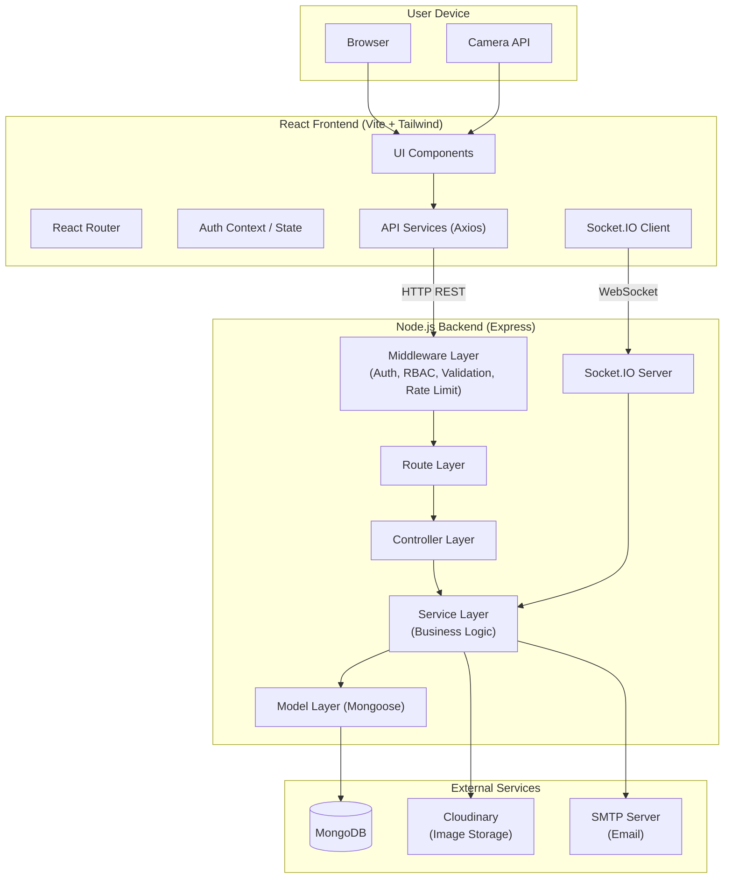
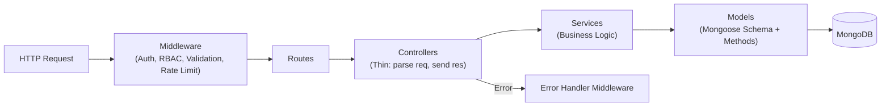
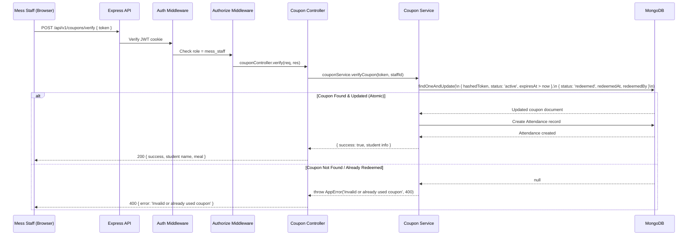
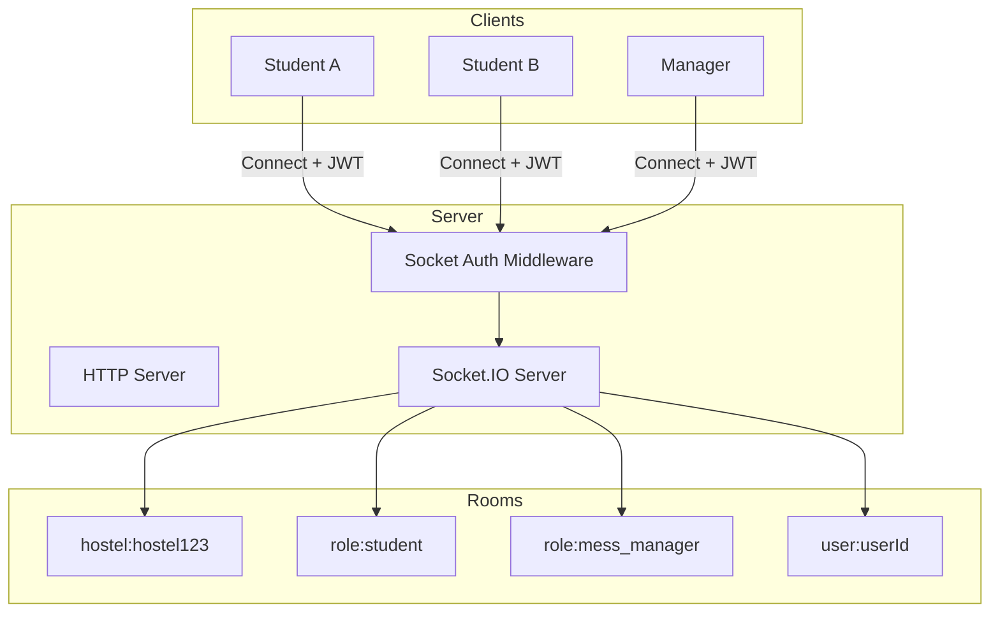

# MessMate — System Architecture Document

> **Version:** 1.0  
> **Last Updated:** November 2026

---

## 1. Architecture Overview

MessMate follows a **modular monolithic architecture** with clear separation between frontend and backend.

**Why monolithic (not microservices)?**
- Single development team
- Shared database simplifies data consistency
- Easier deployment and debugging
- No inter-service communication overhead
- Can evolve into microservices later if needed



---

## 2. Technology Stack

### Frontend

| Technology | Version | Purpose | Rationale |
|-----------|---------|---------|-----------|
| React | 18+ | UI library | Component-based, large ecosystem, hooks |
| Vite | 5+ | Build tool | Fast HMR, optimized builds, ES modules |
| Tailwind CSS | 3+ | Styling | Utility-first, rapid prototyping, consistent design |
| React Router DOM | 6+ | Routing | Standard React routing, nested routes, guards |
| Axios | 1.6+ | HTTP client | Interceptors, request/response transforms |
| Context API | — | Global state (auth) | Built-in, sufficient for auth and theme |
| Redux Toolkit | 2+ | Complex state (optional) | Only if heavily shared state emerges |
| Recharts | 2+ | Charts/analytics | React-native, responsive, good API |
| React Hook Form | 7+ | Form handling | Best performance, uncontrolled components |
| Zod | 3+ | Validation schemas | Type-safe, composable, works with RHF |
| html5-qrcode | 2+ | QR scanning | Camera-based, cross-browser, well-maintained |
| qrcode | 1.5+ | QR generation | Generates QR data URLs for display |
| Lucide React | — | Icons | Clean, consistent icon set |
| React Hot Toast | — | Toast notifications | Lightweight, beautiful defaults |
| date-fns | 3+ | Date utilities | Lightweight, immutable, tree-shakeable |

### Backend

| Technology | Version | Purpose | Rationale |
|-----------|---------|---------|-----------|
| Node.js | 18+ | Runtime | JavaScript everywhere, non-blocking I/O |
| Express.js | 4+ | Web framework | Minimal, flexible, vast middleware ecosystem |
| Mongoose | 7+ | MongoDB ODM | Schema validation, middleware, population |
| jsonwebtoken | 9+ | JWT handling | Industry standard token library |
| bcryptjs | 2+ | Password hashing | Pure JS bcrypt, no native deps |
| Socket.IO | 4+ | Real-time comms | Reliable WebSocket with fallbacks |
| multer | 1+ | File uploads | Standard multipart form handling |
| cloudinary | 1+ | Image CDN | Scalable cloud storage, transforms |
| nodemailer | 6+ | Email | Standard Node.js email library |
| express-rate-limit | 7+ | Rate limiting | Simple, configurable per-route limiting |
| helmet | 7+ | Security headers | Sensible HTTP header defaults |
| cors | 2+ | CORS | Cross-origin configuration |
| cookie-parser | 1+ | Cookie handling | Parse JWT cookies |
| express-validator | 7+ | Input validation | Middleware-based validation chains |
| morgan | 1+ | HTTP logging | Request logging for development |
| crypto (built-in) | — | Token generation | Cryptographically secure random tokens |

### Database

| Technology | Purpose |
|-----------|---------|
| MongoDB 6+ | Document database — flexible schemas, good for nested structures |
| MongoDB Atlas | Cloud hosting option for production |

### Dev & Testing

| Technology | Purpose |
|-----------|---------|
| Vitest | Unit and integration testing (frontend) |
| Jest + Supertest | API integration testing (backend) |
| swagger-jsdoc + swagger-ui-express | Auto-generated API documentation |
| ESLint + Prettier | Code quality and formatting |
| nodemon | Backend hot reload in development |

---

## 3. Project Structure

```
MessMate/
│
├── client/                          # React Frontend
│   ├── public/                      # Static public assets
│   ├── src/
│   │   ├── assets/                  # Images, fonts, static files
│   │   ├── components/              # Reusable UI components
│   │   │   ├── common/              # Button, Input, Card, Modal, Table,
│   │   │   │                        #   Badge, Avatar, EmptyState, Skeleton
│   │   │   ├── forms/               # FormField, SearchInput, DatePicker,
│   │   │   │                        #   Select, FileUpload, StarRating
│   │   │   └── layout/              # Sidebar, Header, Footer,
│   │   │                            #   MobileNav, NotificationBell
│   │   ├── layouts/                 # Page-level layouts
│   │   │   ├── AuthLayout.jsx       # Centered layout for login/register
│   │   │   └── DashboardLayout.jsx  # Sidebar + header + content
│   │   ├── pages/                   # Route pages by role
│   │   │   ├── auth/                # Login, Register, ForgotPassword, ResetPassword
│   │   │   ├── student/             # Dashboard, Menu, Declarations, Coupons,
│   │   │   │                        #   Feedback, Complaints, Attendance, GuestMeals
│   │   │   ├── staff/               # Dashboard, Scanner, ManualVerify, WastageEntry
│   │   │   ├── manager/             # Dashboard, MenuEditor, Demand, Inventory,
│   │   │   │                        #   Complaints, Wastage, GuestMeals, Announcements
│   │   │   ├── warden/              # Dashboard, Analytics, Complaints, Reports
│   │   │   └── admin/               # Dashboard, Users, Hostels, MessFacilities, Config
│   │   ├── hooks/                   # Custom hooks (useAuth, useSocket, useFetch, etc.)
│   │   ├── context/                 # React Context providers (AuthContext, SocketContext)
│   │   ├── services/                # API call functions organized by module
│   │   │   ├── api.js               # Axios instance configuration
│   │   │   ├── authService.js
│   │   │   ├── menuService.js
│   │   │   ├── couponService.js
│   │   │   ├── declarationService.js
│   │   │   └── ...
│   │   ├── routes/                  # Route definitions and guards
│   │   │   ├── AppRoutes.jsx        # All route definitions
│   │   │   ├── ProtectedRoute.jsx   # Auth guard
│   │   │   └── RoleRoute.jsx        # Role-based guard
│   │   ├── utils/                   # Helper functions (formatDate, constants, etc.)
│   │   ├── constants/               # App-wide constants (roles, statuses, etc.)
│   │   ├── App.jsx                  # Root component
│   │   └── main.jsx                 # Entry point
│   ├── index.html
│   ├── tailwind.config.js
│   ├── vite.config.js
│   └── package.json
│
├── server/                          # Express Backend
│   ├── src/
│   │   ├── config/
│   │   │   ├── database.js          # MongoDB connection
│   │   │   ├── cloudinary.js        # Cloudinary config
│   │   │   ├── email.js             # Nodemailer transporter config
│   │   │   └── constants.js         # Roles, statuses, meal types
│   │   ├── models/                  # Mongoose schemas (17 models)
│   │   │   ├── User.js
│   │   │   ├── Hostel.js
│   │   │   ├── MessFacility.js
│   │   │   ├── MealSession.js
│   │   │   ├── Menu.js
│   │   │   ├── MealDeclaration.js
│   │   │   ├── Coupon.js
│   │   │   ├── Attendance.js
│   │   │   ├── Feedback.js
│   │   │   ├── Complaint.js
│   │   │   ├── InventoryItem.js
│   │   │   ├── StockTransaction.js
│   │   │   ├── WasteLog.js
│   │   │   ├── GuestMealRequest.js
│   │   │   ├── Notification.js
│   │   │   ├── Announcement.js
│   │   │   └── AuditLog.js
│   │   ├── controllers/             # Request handlers (thin)
│   │   │   ├── authController.js
│   │   │   ├── userController.js
│   │   │   ├── hostelController.js
│   │   │   ├── messController.js
│   │   │   ├── menuController.js
│   │   │   ├── mealSessionController.js
│   │   │   ├── declarationController.js
│   │   │   ├── couponController.js
│   │   │   ├── attendanceController.js
│   │   │   ├── feedbackController.js
│   │   │   ├── complaintController.js
│   │   │   ├── inventoryController.js
│   │   │   ├── wasteLogController.js
│   │   │   ├── guestMealController.js
│   │   │   ├── kitchenController.js
│   │   │   ├── notificationController.js
│   │   │   ├── announcementController.js
│   │   │   ├── dashboardController.js
│   │   │   ├── demandController.js
│   │   │   └── auditLogController.js
│   │   ├── routes/                  # Express route definitions
│   │   │   ├── index.js             # Route aggregator
│   │   │   ├── authRoutes.js
│   │   │   ├── userRoutes.js
│   │   │   ├── hostelRoutes.js
│   │   │   ├── messRoutes.js
│   │   │   ├── menuRoutes.js
│   │   │   └── ... (one per resource)
│   │   ├── middleware/
│   │   │   ├── auth.js              # JWT verification
│   │   │   ├── authorize.js         # Role-based access
│   │   │   ├── errorHandler.js      # Global error handler
│   │   │   ├── rateLimiter.js       # Rate limiting configs
│   │   │   ├── validate.js          # Validation middleware runner
│   │   │   └── upload.js            # Multer + Cloudinary upload
│   │   ├── services/                # Business logic
│   │   │   ├── authService.js
│   │   │   ├── couponService.js
│   │   │   ├── demandService.js
│   │   │   ├── notificationService.js
│   │   │   ├── emailService.js
│   │   │   └── auditService.js
│   │   ├── validators/              # express-validator chains
│   │   │   ├── authValidators.js
│   │   │   ├── userValidators.js
│   │   │   └── ...
│   │   ├── utils/
│   │   │   ├── AppError.js          # Custom error class
│   │   │   ├── asyncHandler.js      # Async error wrapper
│   │   │   ├── helpers.js           # General helpers
│   │   │   └── tokenUtils.js        # Token generation utilities
│   │   ├── sockets/
│   │   │   ├── index.js             # Socket.IO setup
│   │   │   └── handlers.js          # Event handlers
│   │   ├── app.js                   # Express app configuration
│   │   └── server.js                # HTTP server + Socket.IO startup
│   ├── tests/                       # Test files
│   │   ├── auth.test.js
│   │   ├── coupon.test.js
│   │   └── ...
│   ├── .env.example
│   └── package.json
│
├── docs/                            # Project documentation
│   ├── PROJECT_REQUIREMENTS.md
│   ├── SYSTEM_ARCHITECTURE.md
│   ├── DATABASE_SCHEMA.md
│   ├── API_DOCUMENTATION.md
│   └── IMPLEMENTATION_PLAN.md
│
├── .gitignore
├── README.md
└── package.json                     # Root workspace scripts
```

---

## 4. Backend Architecture Layers

### Layer Diagram



### Layer Responsibilities

**Routes Layer** — Maps HTTP methods + paths to controller functions. No logic here.
```javascript
// routes/menuRoutes.js
router.get('/current', authenticate, menuController.getCurrentWeekMenu);
router.post('/', authenticate, authorize('mess_manager'), validateMenu, menuController.createMenu);
```

**Controller Layer** — Parses request, calls service, sends response. No business logic.
```javascript
// controllers/menuController.js
export const createMenu = asyncHandler(async (req, res) => {
  const menu = await menuService.createMenu(req.body, req.user);
  res.status(201).json({ success: true, data: menu });
});
```

**Service Layer** — Contains all business logic, validates rules, interacts with models.
```javascript
// services/menuService.js
export const createMenu = async (data, user) => {
  const mess = await MessFacility.findById(data.messId);
  if (!mess) throw new AppError('Mess facility not found', 404);
  // ... business validation ...
  const menu = await Menu.create({ ...data, createdBy: user._id });
  await auditService.log(user._id, 'CREATE_MENU', 'Menu', menu._id);
  return menu;
};
```

**Model Layer** — Schema definitions, validation, hooks, instance/static methods, indexes.

### Request Flow — Coupon Redemption Example



---

## 5. Authentication & Authorization

### JWT Cookie Flow

```mermaid
sequenceDiagram
    participant Browser
    participant API as Express Server
    participant DB as MongoDB

    Browser->>API: POST /api/v1/auth/login { email, password }
    API->>DB: Find user by email
    DB-->>API: User document
    API->>API: Compare password (bcrypt)
    API->>API: Generate JWT (userId, role)
    API-->>Browser: Set-Cookie: token=JWT; HttpOnly; Secure; SameSite=Lax
    
    Note over Browser: JWT stored in HTTP-only cookie (not accessible via JS)
    
    Browser->>API: GET /api/v1/auth/me (Cookie: token=JWT)
    API->>API: Parse cookie, verify JWT
    API->>DB: Find user by decoded ID
    DB-->>API: User document
    API-->>Browser: 200 { user data }
```

### Auth Middleware

```javascript
// 1. Extract JWT from HTTP-only cookie
// 2. Verify token (jsonwebtoken.verify)
// 3. Find user in DB
// 4. Attach user to req.user
// 5. Call next() or throw 401
```

### RBAC Middleware

```javascript
// authorize(...allowedRoles) returns middleware that:
// 1. Checks req.user.role exists
// 2. Checks if role is in allowedRoles
// 3. Passes or throws 403 Forbidden
```

### Role Hierarchy

| Role | Numeric Level | Can Access |
|------|--------------|------------|
| admin | 5 | Everything |
| warden | 4 | Oversight + complaints + analytics |
| mess_manager | 3 | Mess operations + inventory + menus |
| mess_staff | 2 | Scanning + attendance + wastage entry |
| student | 1 | Own data + menus + declarations + feedback |

---

## 6. Real-Time Communication (Socket.IO)

### Architecture



### Events

| Event | Direction | Description |
|-------|-----------|-------------|
| `notification:new` | Server → Client | New notification for user |
| `meal:session-update` | Server → Room | Meal session status changed |
| `attendance:count` | Server → Room | Live attendance count update |
| `announcement:new` | Server → Room | New announcement published |
| `complaint:update` | Server → User | Complaint status changed |

---

## 7. Security Architecture

| Measure | Implementation |
|---------|---------------|
| **HTTP Headers** | Helmet middleware (X-Frame-Options, CSP, HSTS, etc.) |
| **CORS** | Whitelist frontend origin, credentials: true |
| **Rate Limiting** | 100 req/15min general; 20/15min auth; 30/min coupon verify |
| **Input Validation** | express-validator on all endpoints |
| **NoSQL Injection** | Mongoose schema validation, sanitize inputs |
| **XSS** | Input sanitization, Content Security Policy |
| **Password Security** | bcrypt with 12 salt rounds |
| **Token Security** | HTTP-only cookies, secure flag in production |
| **File Uploads** | Type validation, size limits (5MB), Cloudinary storage |
| **Audit Trail** | All privileged operations logged with user, action, timestamp |
| **Secrets** | Environment variables, .env.example without real values |
| **Atomic Operations** | findOneAndUpdate for coupon redemption |

---

## 8. Error Handling

### Custom Error Class

```javascript
class AppError extends Error {
  constructor(message, statusCode) {
    super(message);
    this.statusCode = statusCode;
    this.isOperational = true;
  }
}
```

### Global Error Handler

```javascript
// Catches all errors passed via next(err) or thrown in asyncHandler
// Formats response as: { success: false, error: { message, code } }
// Handles: CastError, ValidationError, duplicate key, JWT errors
// In production: hides stack traces and internal details
```

### Async Handler Wrapper

```javascript
const asyncHandler = (fn) => (req, res, next) => {
  Promise.resolve(fn(req, res, next)).catch(next);
};
```

---

## 9. Deployment Architecture

### Development

```
Frontend: http://localhost:5173 (Vite dev server)
Backend:  http://localhost:5000 (Express + Socket.IO)
Database: mongodb://localhost:27017/messmate_dev
```

Vite proxies `/api` requests to the backend during development.

### Production Considerations

- Frontend built with `vite build`, served as static files or via CDN
- Backend deployed on Railway / Render / VPS
- MongoDB Atlas for managed database
- Cloudinary for image storage
- Environment variables configured per deployment platform
- CORS set to production frontend domain

---

## 10. Scalability Path

| Current | Future Enhancement |
|---------|-------------------|
| Single server | Load balancer + multiple instances |
| Local session state | Redis for session/socket state |
| MongoDB single replica | MongoDB replica set / sharded cluster |
| Direct file upload | Upload queue + CDN |
| In-app notifications | Push notifications, email digests |
| Single hostel focus | Multi-tenant architecture |
| Statistical forecasting | ML-based demand prediction |

